<p align="center"></p>

# Opsis Media Player Pro

<p align="center">
  <strong>Ένας γρήγορος, όμορφος player βίντεο και ήχου με τον κινητήρα του VLC και τις συντομεύσεις του Media Player Classic.</strong><br/>
  <strong>A fast, good-looking video and audio player on the VLC engine with Media Player Classic shortcuts.</strong>
</p>

<p align="center">
  
  
  
  
</p>

*English below / Αγγλικά παρακάτω.*

## Ελληνικά

Το **Opsis Media Player Pro** παίζει σχεδόν κάθε μορφή (mp4, mkv, avi, mov, webm, ts, flac, mp3, opus…), δίκτυο (http, rtsp, udp…), DVD φακέλους και κάμερες. Χρησιμοποιεί τον κινητήρα **LibVLC** και έχει τη διάταξη, τα πλήκτρα και τις επιλογές που περιμένεις από **Media Player Classic / VLC**, με σύγχρονη εμφάνιση.

| Κατηγορία | Τι έχει |
|---|---|
| ▶ Αναπαραγωγή | Καρέ-καρέ, ταχύτητα 0,25–4× (`[` `]` `=`), επανάληψη A-B, κεφάλαια και τίτλοι, σελιδοδείκτες, μετάβαση σε χρόνο, χρόνος που απομένει, **μνήμη θέσης** ανά αρχείο, χρονόμετρο ύπνου, ενέργεια μετά το τέλος |
| 🔊 Ήχος | Equalizer 10 ζωνών με προεπιλογές, preamp, εφέ (Clarity, Ambience, Surround, Dynamic Boost, Bass Boost), κανονικοποίηση έντασης, συμπιεστής, οπτικοποιήσεις, **συσκευή εξόδου**, κανάλια (στερεο, αντίστροφο, αριστερό, δεξί, Dolby), καθυστέρηση ήχου, ένταση έως 200% |
| 🎞 Βίντεο | Αναλογία εικόνας, περικοπή, zoom, **περιστροφή/αναστροφή**, αποπλεξία, όξυνση, φωτεινότητα/αντίθεση/κορεσμός/gamma, στιγμιότυπο (αρχείο ή πρόχειρο), προσαρμογή παραθύρου στο βίντεο |
| 💬 Υπότιτλοι | Λήψη από **Podnapisi**, **OpenSubtitles.com** (με δικό σου κλειδί) και Subs4Free με **έξυπνη κατάταξη** (σεζόν/επεισόδιο, έτος, ανάλυση, πηγή, ομάδα· σύγκριση των 3 καλύτερων με τη διάρκεια του βίντεο), υποστήριξη `.srt` `.vtt` `.ass` `.ssa` και UTF-8/16/ελληνικών κωδικοποιήσεων, **αυτόματος συγχρονισμός με τον ήχο** (μετατόπιση ±5′ με ακρίβεια 20 ms **και απόκλιση fps** από δύο τμήματα της ταινίας), συγχρονισμός στη γραμμή που ακούγεται (`Y`), καθυστέρηση (`Z` `X`), εναλλαγή καναλιού (`V`) |
| 📂 Λίστα | M3U, ταξινόμηση, μετακίνηση πάνω/κάτω, τυχαία σειρά, επανάληψη λίστας ή αρχείου, διακοπή μετά το τρέχον, πρόσφατα, μενού δεξιού κλικ (φάκελος, αντιγραφή διαδρομής) |
| 👋 Καλωσόρισμα και οικογένεια Opsis | Οδηγός χρήσης στην πρώτη εκκίνηση κάθε νέας έκδοσης, κάρτες όλων των εφαρμογών της οικογένειας με Άνοιγμα / Λήψη με SHA-256, ειδοποίηση νέας έκδοσης μέσα στο παράθυρο |
| 🎨 Εμφάνιση | 16 θέματα, χρώμα έμφασης, δικά σου θέματα `.json`, **κουμπί σκούρας/φωτεινής/αυτόματης λειτουργίας** που ισχύει σε ΟΛΑ τα παράθυρα (και στη γραμμή τίτλου), στρογγυλεμένα μενού, πλευρικό πάνελ με εξώφυλλο και πληροφορίες ταινίας/σειράς |
| 🧰 Εργαλεία | **Μετατροπέας βίντεο/εικόνας** (MP4, WebM, MKV, AVI, WMV, TS, OGV· PNG/JPEG καρέ, poster, contact sheet· ουρά, trim A-B — μόνο μορφές που παράγει πραγματικά το libvlc, βλ. [docs/CONVERTER.md](docs/CONVERTER.md)· έξοδος στο `Videos\Opsis Media Player`), εξαγωγή MP3, εξαγωγή κλιπ A-B, στατιστικά αναπαραγωγής (`Ctrl+J`), αποστολή σε Chromecast/DLNA, θυμάται θέση και μέγεθος παραθύρου |

### Συντομεύσεις (οι βασικές — όλες στο `F1`)

`Space` παύση · `←/→` ∓5″ · `Shift+←/→` ∓15″ · `Ctrl+←/→` ∓30″ · `Alt+←/→` ∓1″ · `Ctrl+Shift+←/→` ∓5′ · `↑/↓` ένταση · `M` σίγαση · `F11`/`Enter` πλήρης οθόνη · `[` `]` `=` ταχύτητα · `E` καρέ-καρέ · `L` A-B · `Home`/`End` προηγούμενο/επόμενο · `PgUp`/`PgDn` κεφάλαια · `S` στιγμιότυπο · `Ctrl+C` στιγμιότυπο στο πρόχειρο · `V` υπότιτλοι · `B` κανάλι ήχου · `T` χρόνος · `Ctrl+E` ενισχυτής ήχου · `Ctrl+J` στατιστικά · `Ctrl+Shift+L` σκούρη/φωτεινή/αυτόματη.

### Ιδιωτικότητα — τι επικοινωνεί με το διαδίκτυο

- **Έλεγχος νέας έκδοσης** (ενεργός από προεπιλογή, Βοήθεια → «Ειδοποίηση για νέες εκδόσεις»): 30″ μετά την εκκίνηση και μετά κάθε 24 ώρες ένα `GET` στο `api.github.com/repos/giorstergiopoulos-design/OpsisMediaPlayerPro/releases/latest` (με ETag, timeout 8″). Στέλνεται μόνο αυτό το αίτημα, χωρίς δεδομένα σου. Μία ειδοποίηση ανά έκδοση, μέσα στο παράθυρο.
- **Κατάλογος εφαρμογών της οικογένειας** (παράθυρο «Οι εφαρμογές της οικογένειας Opsis»): το πολύ μία λήψη την ημέρα του `suite/apps.json` από το GitHub (έγκυρο μόνο αν έρχεται από github.com, ≤256 KB και περνά έλεγχο)· διαφορετικά χρησιμοποιείται το ενσωματωμένο αντίγραφο. Ο έλεγχος «εγκατεστημένο» διαβάζει μόνο το registry και γνωστούς φακέλους.
- **Λήψη εφαρμογής από το παράθυρο**: μόνο μετά από επιβεβαίωση (όνομα, μέγεθος, πηγή), με έλεγχο SHA-256 και ΑΡΝΗΣΗ αν δεν ταιριάζει· δεν εκτελείται ποτέ αυτόματα.

- **Αυτόματη λήψη υποτίτλων** (ενεργή από προεπιλογή): όταν ανοίγεις βίντεο χωρίς αρχείο υποτίτλων, στέλνεται ένα καθαρισμένο όνομα (και, για το OpenSubtitles, ένα hash του αρχείου) στο Podnapisi/OpenSubtitles. Για αρχεία **ήχου** δεν γίνεται αναζήτηση.
- **Πληροφορίες ταινίας/σειράς** (ενεργές από προεπιλογή): ο καθαρισμένος τίτλος αποστέλλεται σε TVmaze, iTunes και Wikipedia για εξώφυλλο και περιγραφή.
- Και τα δύο κλείνουν (Ρυθμίσεις → Υπότιτλοι → Ρυθμίσεις υποτίτλων, και Προβολή → Πλευρικό πάνελ). Δεν υπάρχει τηλεμετρία.

### Wave και ρυθμίσεις / Wave and settings

Θέματα -> Εμφάνιση εφαρμογής -> Classic ή Wave (άμεση αλλαγή) και Θέματα -> Ρυθμίσεις… (κατηγορίες). / Themes -> Interface -> Classic or Wave (live) and Themes -> Settings… (categories).

| Wave σκούρο / dark | Wave φωτεινό / light |
|---|---|
| 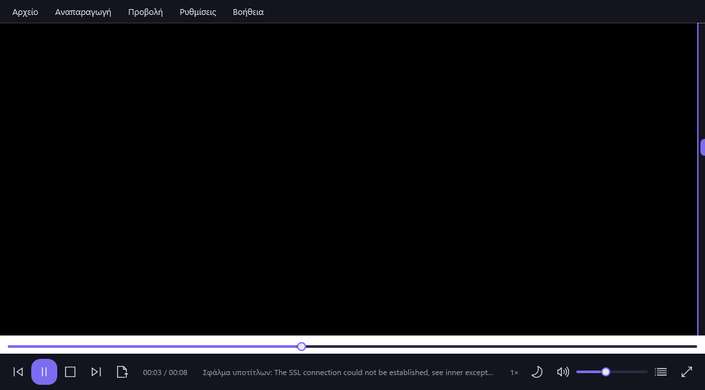 | 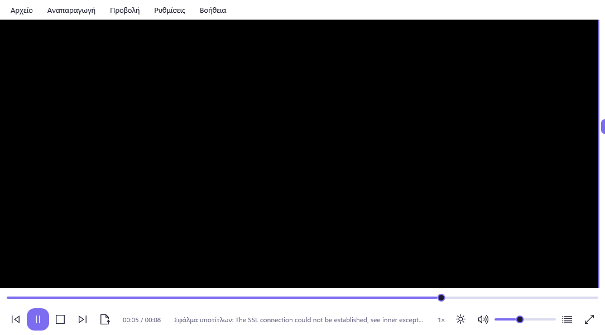 |
| 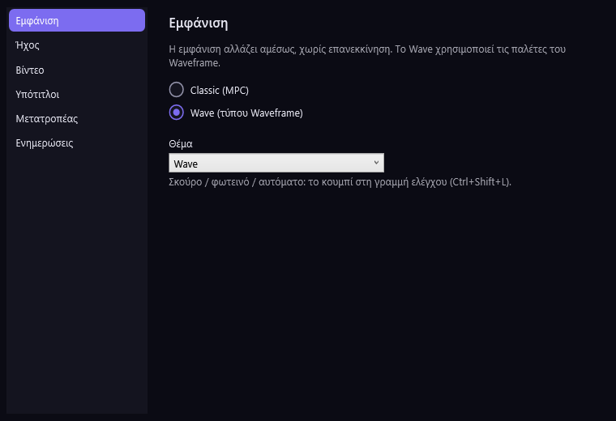 | 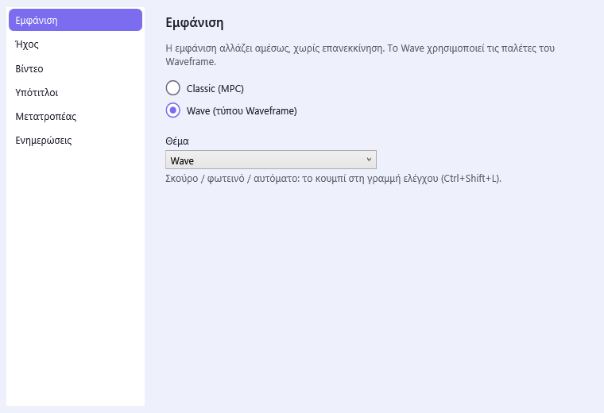 |

### Στιγμιότυπα / Screenshots

| Σκούρο / Dark | Φωτεινό / Light |
|---|---|
| 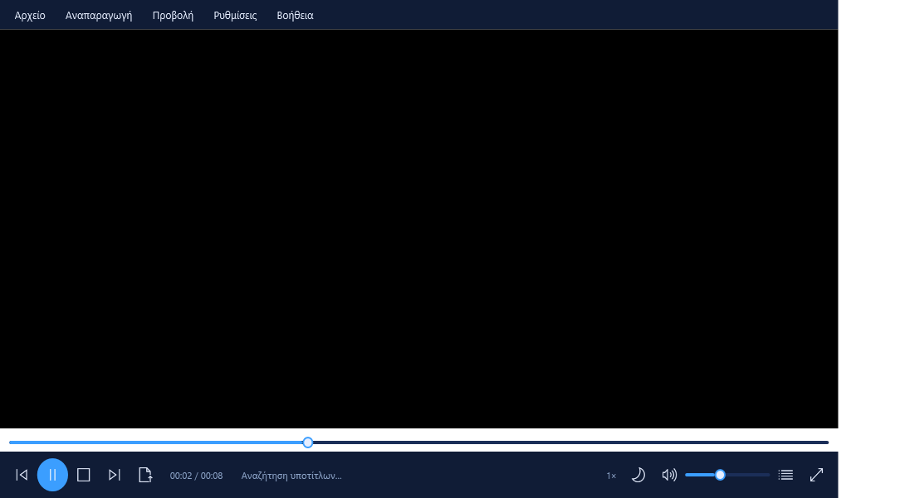 | 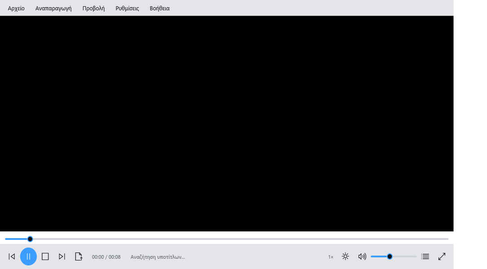 |
| 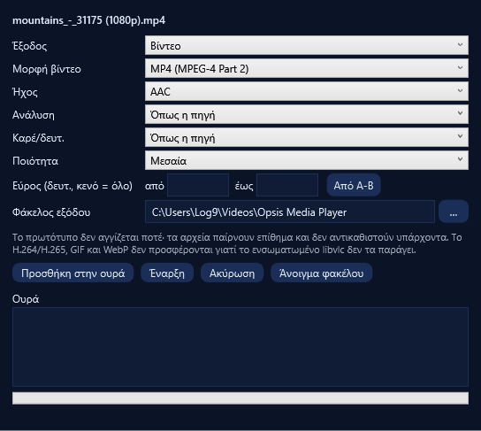 | 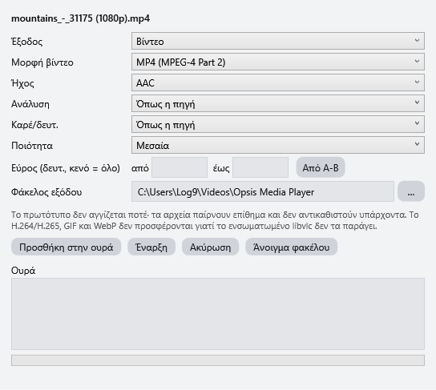 |
| 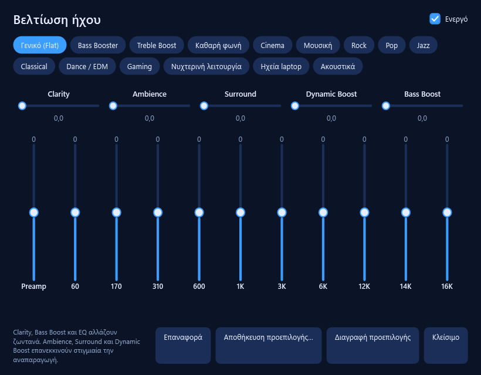 | 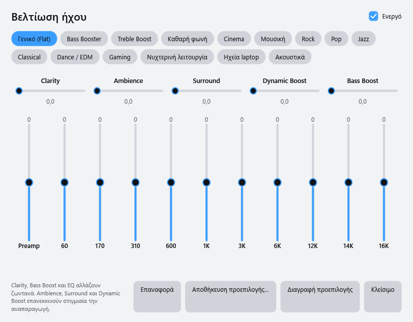 |
|  | 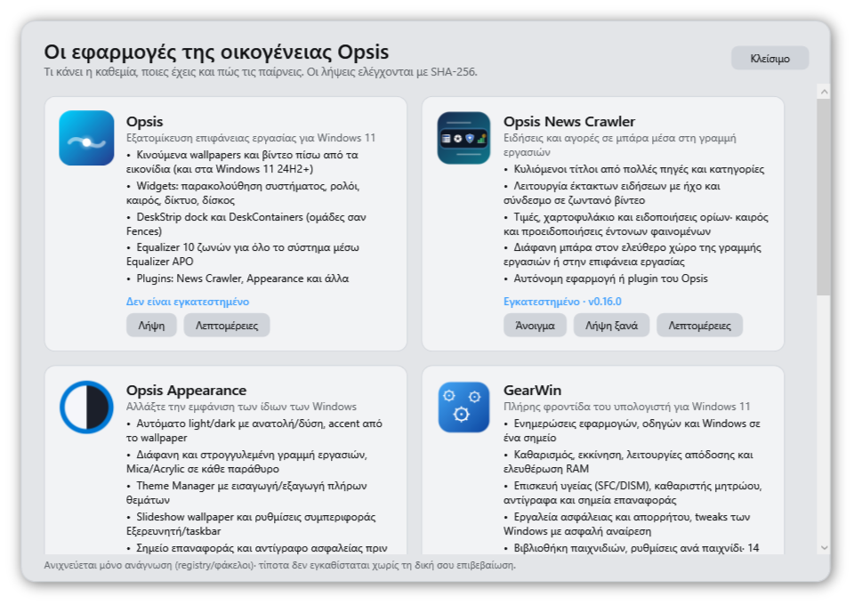 |

*(Real windows of this build, generated by `OpsisMediaPlayerPro.exe --snapshots`. The video area is black in the captures because the video surface is not part of the WPF render.)*

### Εγκατάσταση και έλεγχος SHA-256

Από τα [Releases](../../releases/latest): `OpsisMediaPlayerPro-Setup.exe` (χωρίς admin, ελληνικά/αγγλικά) ή το zip `OpsisMediaPlayerPro-<έκδοση>.zip` (φορητό — κράτα όλον τον φάκελο μαζί). Το πακέτο είναι **αυτόνομο** (περιέχει το .NET και το libvlc, γι' αυτό είναι μεγάλο) και δεν χρειάζεται εγκατάσταση .NET.

Επαλήθευση: `Get-FileHash .\OpsisMediaPlayerPro-Setup.exe -Algorithm SHA256` και σύγκριση με το αρχείο `.sha256` δίπλα του στο release. **Verify:** compare the hash with the `.sha256` file published next to each asset.

### Χτίσιμο και δοκιμές

```powershell
powershell -File build.ps1              # self-test + publish + zip + installer (Inno Setup 7)
powershell -File tests\run-selftest.ps1 # μόνο το self-test
```

Απαιτείται: [.NET 10 SDK](https://dotnet.microsoft.com/download/dotnet/10.0), [Inno Setup 7](https://jrsoftware.org/isdl.php) για τον installer.

**Δοκιμές υποτίτλων:** `tests\SubtitleTests` (136 unit tests incl. the converter) δοκιμάζει την ανάγνωση/εγγραφή SRT, τη μετατροπή VTT/ASS, την αναγνώριση κωδικοποίησης, την κατάταξη υποτίτλων και τον συγχρονισμό με **συνθετικό ήχο με γνωστή μετατόπιση και απόκλιση** (σταθερή μετατόπιση, 25↔23,976 fps, άγνωστος λόγος, μουσική χωρίς υπότιτλους, άσχετος ήχος που πρέπει να απορρίπτεται). Το self-test περιλαμβάνει και πλήρη έλεγχο με **πραγματική εξαγωγή ήχου από το LibVLC**. Τα όρια βεβαιότητας βαθμονομήθηκαν σε συνθετικά δεδομένα· σε πραγματικές ταινίες (μουσική, εφέ) μπορεί να απορρίπτουν ένα σωστό συγχρονισμό — τότε ισχύει ο χειροκίνητος (`Y`, `Z`/`X`). Οι νέες παράμετροι αναζήτησης (σεζόν/επεισόδιο) προς Podnapisi/OpenSubtitles δεν δοκιμάστηκαν με πραγματικές αιτήσεις δικτύου.

**Δοκιμές εφαρμογής:** το `OpsisMediaPlayerPro.exe --selftest <αρχείο>` εκτελεί **κάθε κουμπί και κάθε στοιχείο μενού** σε πραγματική αναπαραγωγή, ανοίγει τα δυναμικά μενού και εφαρμόζει όλα τα θέματα· αναφέρει ως FAIL κάθε εντολή που ρίχνει εξαίρεση ή αφήνει τον player σε κατάσταση σφάλματος και γράφει το `%TEMP%\opsis_mediaplayer_selftest.txt`. Ένα στατικό script (`tests\audit-menus.py`) ελέγχει ότι κάθε `Tag` του μενού έχει handler. Εξαιρούνται από το self-test όσα ανοίγουν modal παράθυρο, δίκτυο ή κάνουν κάτι μη αναστρέψιμο (άνοιγμα αρχείου, μετατροπή, λήψη υποτίτλων, έξοδος…). Δεν ελέγχεται αυτόματα το **οπτικό αποτέλεσμα** (π.χ. ότι η περιστροφή φαίνεται σωστά στην εικόνα).

## English

**Opsis Media Player Pro** plays almost any format (mp4, mkv, avi, mov, webm, ts, flac, mp3, opus…), network streams (http, rtsp, udp…), DVD folders and capture devices. It is built on **LibVLC** and offers the layout, keys and options you expect from **Media Player Classic / VLC** with a modern look.

**Converter:** video (MP4, WebM, MKV, AVI, WMV, TS, OGV) and image outputs (PNG/JPEG frames, poster, contact sheet) with queue, A-B trim, ETA and cancel; output goes to `Videos\Opsis Media Player` and never overwrites or touches the original. H.264/H.265, GIF and WebP are not offered because the bundled libvlc 3.0.21 cannot produce them — see [docs/CONVERTER.md](docs/CONVERTER.md).

Highlights: frame step, speed 0.25–4×, A-B loop, chapters/titles, bookmarks, per-file resume, 10-band equalizer and effects, output-device and channel selection, aspect/crop/zoom/rotate/flip/deinterlace/colour adjustments, subtitle download (Podnapisi, OpenSubtitles.com with your key, Subs4Free) with audio-based sync, M3U playlists, 16 themes with a light/dark/auto button, MP4/MP3 conversion, A-B clip export, playback statistics (`Ctrl+J`), Chromecast/DLNA, and window position memory.

**Privacy:** automatic subtitle download and online movie/series information are **on by default** and send a cleaned-up title derived from the file name (and, for OpenSubtitles, a file hash) to Podnapisi/OpenSubtitles, TVmaze, iTunes and Wikipedia. Audio files are never searched. Both can be turned off in the settings. No telemetry. Once a day one GET goes to the GitHub releases API to look for a new version (switch it off in the Help menu) and the app catalogue of the "Opsis family" window is fetched from GitHub at most once a day (validated: github.com only, 256 KB max); apps are downloaded only after your confirmation and a SHA-256 check.

**Install:** download `OpsisMediaPlayerPro-Setup.exe` (no admin) or the portable zip from [Releases](../../releases/latest). The package is self-contained (.NET + libvlc included, hence its size).

**Subtitle tests:** `tests\SubtitleTests` (136 unit tests incl. the converter) covers SRT parsing/writing, VTT/ASS conversion, encoding detection, candidate ranking and the audio sync against **synthetic audio with a known shift and drift** (constant shift, 25↔23.976 fps, unknown ratio, music without subtitles, unrelated audio that must be rejected). The self-test also runs a full check with **real LibVLC audio extraction**. The confidence thresholds were calibrated on synthetic data; on real films (music, effects) they may reject a correct sync, in which case the manual tools apply (`Y`, `Z`/`X`). The new season/episode query parameters sent to Podnapisi/OpenSubtitles were not tested against the live services.

**App tests:** `OpsisMediaPlayerPro.exe --selftest <file>` runs every button and menu item against a real playback, opens the dynamic menus and applies every theme; anything that throws or leaves the player in an error state is reported as FAIL. A static script (`tests\audit-menus.py`) checks that every menu `Tag` has a handler. Commands that open modal dialogs, use the network or are irreversible are skipped, and the visual result of a command is not verified automatically.

## Structure

```
*.cs / *.xaml        the WPF application (MainWindow + feature partials: Extras, Features2, McFeatures, Subtitles, SubProviders, Meta, Skins, AudioFx, SelfTest, SubCore)
Skins/               example theme files (.json)
installer/           Inno Setup 7 script (+ Greek.isl)
SubCore/             pure subtitle logic (SRT, formats, ranking, audio alignment) — no WPF, unit-tested
tests/               self-test runner, static menu audit, SubtitleTests (xunit)
build.ps1            self-test, publish, zip, installer
```

License: MIT (see [LICENSE](LICENSE)); libvlc and LibVLCSharp are LGPL-2.1+ and are loaded as separate libraries.
